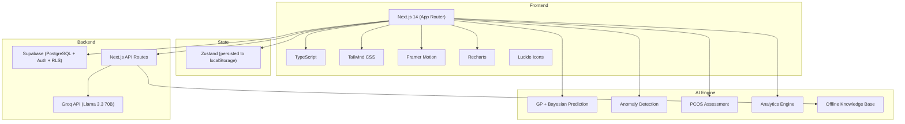
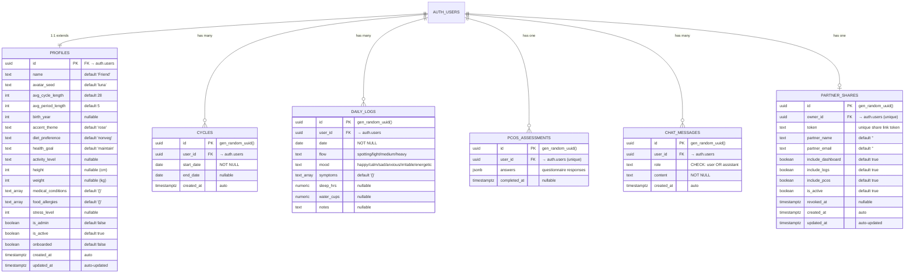
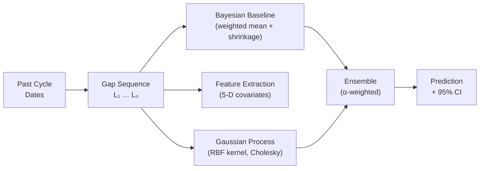
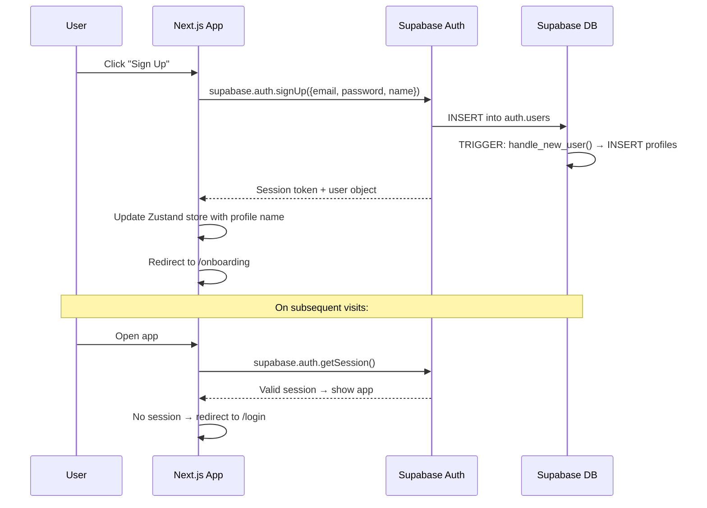

# 🌸 Lotus Phase — Complete Project Deep Dive

> **Presentation-Ready Reference** · A comprehensive guide to the project's code structure, database schema, AI/ML engine, and architecture.

---

## 📌 Table of Contents
1. [📖 Project Overview & Executive Summary](#1-project-overview-&-executive-summary)
2. [🛠 Complete Tech Stack & Dependencies](#2-complete-tech-stack-&-dependencies)
3. [📂 Codebase Directory Map](#3-codebase-directory-map)
4. [🗄 Database Schema & Security (Supabase PostgreSQL)](#4-database-schema-&-security-supabase-postgresql)
5. [🧠 The AI/ML Engine (Client-Side)](#5-the-aiml-engine-client-side)
6. [🔄 Core Application Flows](#6-core-application-flows)
7. [⚙️ Deployment & Configuration](#7-deployment-&-configuration)
8. [🎤 Presentation Guide: Talking Points & FAQ](#8-presentation-guide-talking-points-&-faq)

---

## 1. 📖 Project Overview & Executive Summary

**Lotus Phase** is a **full-stack, AI-powered menstrual health & wellness companion** built as a final-year project. It predicts periods, tracks symptoms, provides AI health insights, and includes an AI chatbot — all wrapped in a premium glassmorphic UI.

### Key Details
| Aspect | Detail |
|---|---|
| **Project Name** | Lotus Phase (codebase name: `lotus-phase`) |
| **Type** | Progressive Web App (PWA) |
| **Purpose** | Period prediction, symptom tracking, AI health insights, and PCOS assessment |
| **Target Users** | Women & menstruating individuals tracking reproductive health |
| **Key Innovation** | Gaussian Process + Bayesian ensemble cycle predictor running entirely client-side |

---

## 2. 🛠 Complete Tech Stack & Dependencies

### High-Level Architecture


### Detailed Dependencies
| Package | Version | Purpose |
|---|---|---|
| `next` | 14.2.5 | React meta-framework (App Router, API routes, SSR) |
| `react` / `react-dom` | 18.3.1 | UI library |
| `typescript` | ^5.5.3 | Type safety |
| `tailwindcss` | ^3.4.6 | Utility-first CSS framework |
| `framer-motion` | ^11.3.8 | Animations & page transitions |
| `recharts` | ^2.12.7 | Charts (mood, sleep, water, cycle length trends) |
| `zustand` | ^4.5.4 | Lightweight state management with persistence middleware |
| `@supabase/supabase-js` | ^2.105.3 | Supabase client SDK |
| `@supabase/ssr` | ^0.10.3 | Server-side rendering Supabase utilities |
| `lucide-react` | ^0.408.0 | Modern icon library |
| `date-fns` | ^3.6.0 | Date manipulation utilities |
| `clsx` + `tailwind-merge` | Latest | Conditional CSS class merging |

---

## 3. 📂 Codebase Directory Map

```
Period-Tracking-Ai/
├── app/                          # Next.js App Router (pages & API)
│   ├── layout.tsx                # Root layout — fonts, theme, toaster
│   ├── page.tsx                  # Landing page (hero, features, testimonials)
│   ├── globals.css               # 33KB — full design system + glassmorphism
│   │
│   ├── (auth)/                   # Route group — unauthenticated pages
│   │   ├── layout.tsx            # Auth layout with decorative illustration
│   │   ├── login/                # Login page
│   │   └── signup/               # Signup page
│   │
│   ├── (app)/                    # Route group — authenticated app shell
│   │   ├── layout.tsx            # App shell: sidebar + mobile nav + auth guard
│   │   ├── template.tsx          # Framer Motion page transition wrapper
│   │   ├── dashboard/            # Main dashboard — countdown ring, charts
│   │   ├── calendar/             # Interactive calendar with prediction overlay
│   │   ├── log/                  # Daily logging — flow, mood, symptoms, sleep, water
│   │   ├── insights/             # AI-generated insight cards
│   │   ├── chat/                 # Luna AI chatbot (streaming)
│   │   ├── community/            # Community feed & ask-a-doctor
│   │   ├── doctor/               # Verified gynaecologist directory
│   │   ├── profile/              # User profile & settings
│   │   ├── stats/                # Research analytics dashboard
│   │   ├── diet/                 # Phase-based diet guide
│   │   ├── wellness/             # Wellness plan per cycle phase
│   │   ├── pcos/                 # PCOS/PCOD risk assessment quiz
│   │   ├── relax/                # Relaxation tools (breathing, sounds)
│   │   ├── guide/                # Educational health guide
│   │   ├── premium/              # Premium features showcase
│   │   └── partner-share/        # Share data with partner
│   │
│   ├── onboarding/               # Post-signup onboarding flow
│   ├── partner/                  # Partner view (shared dashboard)
│   ├── admin/                    # Admin panel for user management
│   │
│   └── api/                      # Next.js API Routes (server-side)
│       ├── chat/                 # POST /api/chat — AI chatbot endpoint
│       ├── diet-plan/            # Personalised diet plan generation
│       ├── wellness-plan/        # Personalised wellness plan
│       ├── guide/                # Health guide content
│       ├── admin/                # Admin APIs
│       ├── embed/                # Widget embedding
│       ├── nearby-care/          # Nearby healthcare providers
│       └── partner-share/        # Partner sharing API
│
├── components/                   # Shared React components
│   ├── sidebar.tsx               # Desktop sidebar navigation
│   ├── mobile-nav.tsx            # Mobile bottom navigation bar
│   ├── topbar.tsx                # Top bar with theme toggle, user
│   ├── bloom-logo.tsx            # Animated Lotus Phase logo
│   ├── partner-share-panel.tsx   # Partner sharing UI panel
│   ├── theme-provider.tsx        # Dark/light mode provider
│   └── ui/                       # Reusable UI primitives
│       ├── button.tsx            # Button component with variants
│       ├── card.tsx              # Card with glassmorphism
│       ├── input.tsx             # Form input component
│       ├── badge.tsx             # Badge/tag component
│       ├── toaster.tsx           # Toast notification system
│       ├── markdown.tsx          # Markdown renderer for chat
│       └── premium.tsx           # Premium feature gates
│
├── lib/                          # Core business logic & utilities
│   ├── auth.ts                   # Supabase auth helpers (signIn, signUp, signOut)
│   ├── adminAuth.ts              # Admin authentication & authorization
│   ├── supabase.ts               # Supabase browser client init
│   ├── supabaseAdmin.ts          # Supabase admin (service role) client
│   ├── store.ts                  # Zustand global state store
│   ├── database.types.ts         # TypeScript types generated from DB schema
│   ├── constants.ts              # App-wide constants
│   ├── confetti.ts               # Celebration animation effects
│   ├── healthReportPdf.ts        # PDF health report generator
│   ├── migrate.ts                # DB migration runner
│   ├── partnerShare.ts           # Partner sharing logic
│   ├── utils.ts                  # General utility functions
│   │
│   ├── ai/                       # ⭐ AI/ML ENGINE (the brain)
│   │   ├── gp.ts                 # Gaussian Process regression (Cholesky inference)
│   │   ├── prediction.ts         # Cycle prediction (GP + Bayesian ensemble)
│   │   ├── insights.ts           # Phase-aware insight generator
│   │   ├── analytics.ts          # Research analytics (CHS, CRI, MAE, correlations)
│   │   ├── anomaly.ts            # Cycle & lifestyle anomaly detection (IQR fences)
│   │   ├── pcos.ts               # PCOS risk assessment + Rotterdam classification
│   │   ├── chat.ts               # Chat provider abstraction (streaming)
│   │   ├── kb.ts                 # Offline medical knowledge base
│   │   ├── diet.ts               # Phase-based diet recommendations
│   │   ├── wellness.ts           # Phase-based wellness plans
│   │   └── stream.ts             # Streaming response utility
│   │
│   ├── db/                       # Database access layer
│   │   ├── profile.ts            # CRUD for user profiles
│   │   ├── cycles.ts             # CRUD for cycle records
│   │   ├── logs.ts               # CRUD for daily logs
│   │   ├── chat.ts               # Chat message persistence
│   │   ├── pcos.ts               # PCOS assessment persistence
│   │   └── admin.ts              # Admin-level queries
│   │
│   └── hooks/
│       └── useUserData.ts        # React hook — syncs Supabase data ↔ Zustand store
│
├── supabase/                     # Supabase configuration
│   └── migrations/
│       ├── 20260508_initial_schema.sql    # Core tables: profiles, cycles, daily_logs, pcos_assessments, chat_messages
│       └── 20260610_partner_shares.sql    # Partner sharing table
```

---

## 4. 🗄 Database Schema & Security (Supabase PostgreSQL)

The project uses **Supabase** — a hosted PostgreSQL database with built-in authentication, real-time subscriptions, and Row Level Security (RLS).

### Entity Relationship (ER) Diagram


### Table Details

#### 1. `profiles` — User Settings & Profile
* **Purpose**: Stores user preferences, physical measurements, and health goals.
* **Relationship**: 1:1 relationship with Supabase's internal `auth.users` schema.
* **Automation**: 
  * Trigger `handle_new_user()` creates a row automatically upon signup.
  * Trigger `profiles_updated_at` updates the `updated_at` timestamp on edits.

#### 2. `cycles` — Menstrual Cycle Records
* **Purpose**: Tracks start and end dates of periods.
* **Constraints**: Unique composite key `(user_id, start_date)` prevents duplicate records.
* **Usage**: Chronologically sorted and analyzed by the statistical cycle prediction engine.

#### 3. `daily_logs` — Daily Health & Lifestyle Tracking
* **Purpose**: Tracks symptoms, mood, water intake, sleep, and notes.
* **Constraints**: Unique key `(user_id, date)` enforces a clean one-log-per-day constraint.
* **Usage**: Key source dataset for anomaly detection and lifestyle-cycle correlation coefficients.

#### 4. `pcos_assessments` — Rotterdam Classification Records
* **Purpose**: Persists answers to the PCOS assessment questionnaire.
* **Type**: `answers` is stored as `JSONB` to handle flexible questionnaire changes.

#### 5. `chat_messages` — LLM Chat History
* **Purpose**: Retains the message threads for Luna AI.
* **Constraints**: Database check constraint: `role IN ('user', 'assistant')`.

#### 6. `partner_shares` — Revocable Share Profiles
* **Purpose**: Manages partner read-access tokens.
* **Granular settings**: Independent booleans for `include_dashboard`, `include_logs`, and `include_pcos`.

---

### Row Level Security (RLS) Policies

> [!IMPORTANT]
> To comply with strict HIPAA-like health data guidelines, Row Level Security is active on **every single table** to prevent cross-tenant access.

| Table | Policy Name | Enforcement Rule |
|---|---|---|
| `profiles` | `"own profile"` | `id = auth.uid()` |
| `cycles` | `"own cycles"` | `user_id = auth.uid()` |
| `daily_logs` | `"own logs"` | `user_id = auth.uid()` |
| `pcos_assessments`| `"own pcos"` | `user_id = auth.uid()` |
| `chat_messages` | `"own chat"` | `user_id = auth.uid()` |
| `partner_shares` | `"own partner shares"`| `owner_id = auth.uid()` (both read & write) |

---

## 5. 🧠 The AI/ML Engine (Client-Side)

### 5.1 Cycle Prediction Engine

> [!TIP]
> **Adaptive GP-Bayesian Ensemble Architecture** runs entirely inside the client's browser (0ms backend latency, 100% privacy).



#### The Core Math:
1. **Bayesian Shrinkage Baseline**:
   * Computes an exponentially-weighted mean of cycle gaps ($\alpha = 0.72$) favoring recent cycles.
   * Standardizes small sample sizes using a population prior derived from clinical data (Prior Mean $\mu = 28$ days, Std Dev $\sigma = 4$ days).
2. **Gaussian Process (GP) Path** — [prediction.ts](file:///d:/Final%20project/Period-Tracking-Ai/lib/ai/prediction.ts):
   * Activated when $\ge 3$ cycle history data points exist.
   * Maps a 5-D covariate feature space per cycle: `[normalized_time, avg_sleep_z, avg_water_z, stress_z, symptom_burden_z]`.
   * Evaluates similarity using the **Radial Basis Function (RBF) Kernel**:
     $$k(x, x') = \sigma_f^2 \cdot \exp\left(-\frac{\|x - x'\|^2}{2\ell^2}\right)$$
   * Resolves posterior predictions with custom Cholesky factorization to avoid numerical instability ([gp.ts](file:///d:/Final%20project/Period-Tracking-Ai/lib/ai/gp.ts)).
3. **Ensemble Blending**:
   * Blends predictions dynamically:
     $$\text{prediction} = \alpha \cdot \text{GP\_Mean} + (1 - \alpha) \cdot \text{Bayesian\_Baseline}$$
   * $\alpha$ transitions from $0.0$ (sparse history baseline) up to $0.9$ (complex GP dominance) as cycles are logged.

---

### 5.2 Anomaly & Outlier Detection

Runs locally using Tukey Interquartile Range (IQR) fences on cycle durations:

```typescript
// IQR outlier fencing formula used in anomaly.ts
const Q1 = sortedGaps[Math.floor(n * 0.25)];
const Q3 = sortedGaps[Math.floor(n * 0.75)];
const IQR = Q3 - Q1;
const lowerFence = Q1 - 1.5 * IQR;
const upperFence = Q3 + 1.5 * IQR;
```

#### Diagnostic Detections ([anomaly.ts](file:///d:/Final%20project/Period-Tracking-Ai/lib/ai/anomaly.ts)):
* **Polymenorrhoea Warning**: 3 consecutive cycles shorter than 22 days.
* **Sleep / Wellness Degradation**: Detects shifts in sleep averages comparing the latest 30 days against the prior 60 days.
* **Cycle Overdue**: Flags when cycles exceed the 95% credible interval upper-bound.

---

### 5.3 Clinical PCOS Risk Profiler ([pcos.ts](file:///d:/Final%20project/Period-Tracking-Ai/lib/ai/pcos.ts))

Rather than basic heuristics, this module evaluates risk mapping to the **Rotterdam 2003 Consensus Criteria** (which requires 2 of 3 diagnostic markers to flag high risk):

| Diagnostic Marker | Heuristics Checked |
|---|---|
| **Oligo/Anovulation** | Chronic cycle duration irregularities. |
| **Hyperandrogenism** | Self-reported clinical acne, severe hair loss, and hirsutism. |
| **Polycystic Ovary Morphology** | Proxied via insulin resistance indicators (cravings, weight gain, fatigue). |

---

### 5.4 Research Analytics Engine ([analytics.ts](file:///d:/Final%20project/Period-Tracking-Ai/lib/ai/analytics.ts))

Computes medical-grade analysis metrics:
* **Cycle Health Score (CHS)**: 0-100 score scoring Cycle Regularity (25%), Lifestyle Integrity (25%), Data completeness (25%), and Symptom stability (25%).
* **Leave-One-Out Cross Validation (LOOCV)**: Computes the Mean Absolute Error (MAE) of prediction accuracy historically.
* **Lifestyle Correlations**: Evaluates the Pearson product-moment correlation coefficient ($r$) between daily metrics (hydration, sleep, stress) and cycle length.

---

### 5.5 AI Chatbot Architecture

#### Hybrid Fallback Strategy:
```
[User Message]
      │
      ├──> GROQ API configured? ──(Yes)──> Stream Llama 3.3 70B
      │                                       (Injected with user metrics)
      └──> (No) ─────────────────────────> Local Medical Knowledge Base Search
                                              (Keyword-weighted retrieval in kb.ts)
```

> [!NOTE]
> Every AI answer automatically appends a clear medical disclaimer block.

---

## 6. 🔄 Core Application Flows

### Authentication sequence


### State Management Strategy ([store.ts](file:///d:/Final%20project/Period-Tracking-Ai/lib/store.ts))

Lotus Phase utilizes a **hybrid sync strategy** managed via a custom react hook ([useUserData.ts](file:///d:/Final%20project/Period-Tracking-Ai/lib/hooks/useUserData.ts)):

```
┌────────────────────────────────┐
│   Zustand (localStorage)       │  ◄─── Instant reads/writes (Works offline)
└───────────────┬────────────────┘
                │
                ▼ (Triggered on state changes)
┌────────────────────────────────┐
│   Supabase PostgreSQL DB       │  ◄─── Cloud sync backup when online
└────────────────────────────────┘
```

---

### Next.js API Routing Layout

| Endpoint | Verb | Description |
|---|---|---|
| `/api/chat` | `POST` | Primary LLM endpoint supporting system message context injection and streaming. |
| `/api/diet-plan` | `POST` | Recommends food and recipes for follicular, luteal, ovulatory, and menstrual phases. |
| `/api/wellness-plan` | `POST` | Phase-aware fitness suggestions, yoga patterns, and energy maps. |
| `/api/nearby-care` | `GET` | Mock API to resolve coordinate-based geo-location of gynecologists. |
| `/api/partner-share` | `GET/POST`| Verifies authentication tokens generated by users for their partners. |

---

## 7. ⚙️ Deployment & Configuration

### Environment Variables Setup

Create a `.env.local` file in the root of the project to setup keys:

```bash
# ── Supabase Configuration ──────────────────────────────────────────────────
NEXT_PUBLIC_SUPABASE_URL=https://your-project.supabase.co
NEXT_PUBLIC_SUPABASE_ANON_KEY=your-anon-key-here
SUPABASE_SERVICE_ROLE_KEY=your-service-role-key-here

# ── AI API Configuration ────────────────────────────────────────────────────
GROQ_API_KEY=your-groq-key-here
GROQ_MODEL=llama-3.3-70b-versatile

# ── Optional Fallbacks ──────────────────────────────────────────────────────
HF_TOKEN=your-huggingface-token-here
```

---

## 8. 🎤 Presentation Guide: Talking Points & FAQ

### Key Talking Points to Wow the Examiners

1. **Why Client-Side Prediction?**
   * *Privacy and Latency:* Menstrual data is highly sensitive health data. Processing mathematical predictions on the client side means user data doesn't leave the device for prediction computations.
2. **Rotterdam 2003 Standardization**:
   * Rather than simple questionnaire point-addition, the profiler matches the three clinical criteria used in real medical checks.
3. **Cholesky Factorization for GP**:
   * Showcases actual linear algebra coding (`lib/ai/gp.ts`), showing statistical modeling knowledge over just wrapping APIs.
4. **Offline Resilience**:
   * The app degrades gracefully. If internet is lost or API tokens aren't configured, the system uses custom search algorithms inside `kb.ts` to answer questions.

---

### Potential Examiner Questions

**Q: How do you handle a new user with zero cycle records?**
* **A:** The system defaults to standard population averages ($\mu = 28$ days, $\sigma = 4$ days). When onboarding inputs their last period, Bayesian Shrinkage blends their profile data into the average, progressively giving custom inputs more weight as history grows.

**Q: How is security handled if data is shared with a partner?**
* **A:** Shared links are governed by unique tokens stored in the `partner_shares` table. The owner has total control over what is visible (dashboard, symptoms, or PCOS risk summary) and can revoke token access instantly at any time.

**Q: Why choose Zustand over Redux?**
* **A:** Zustand is a lightweight state manager that handles hydration and synchronization to `localStorage` effortlessly with minor boilerplate compared to Redux, which is crucial for quick offline reactivity.

---
